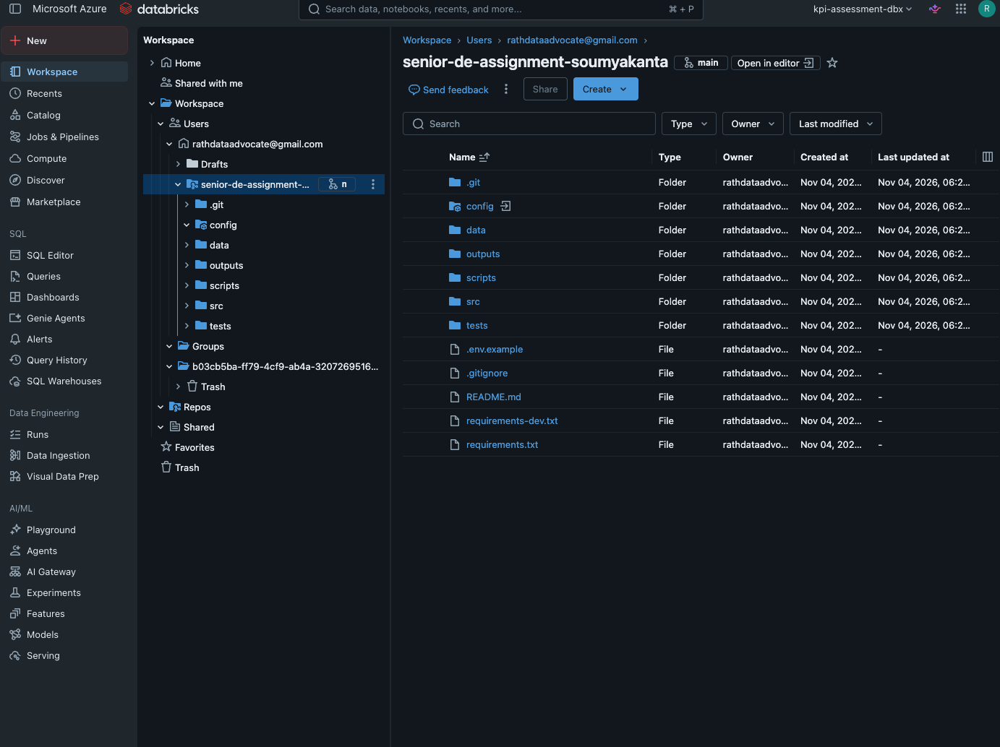
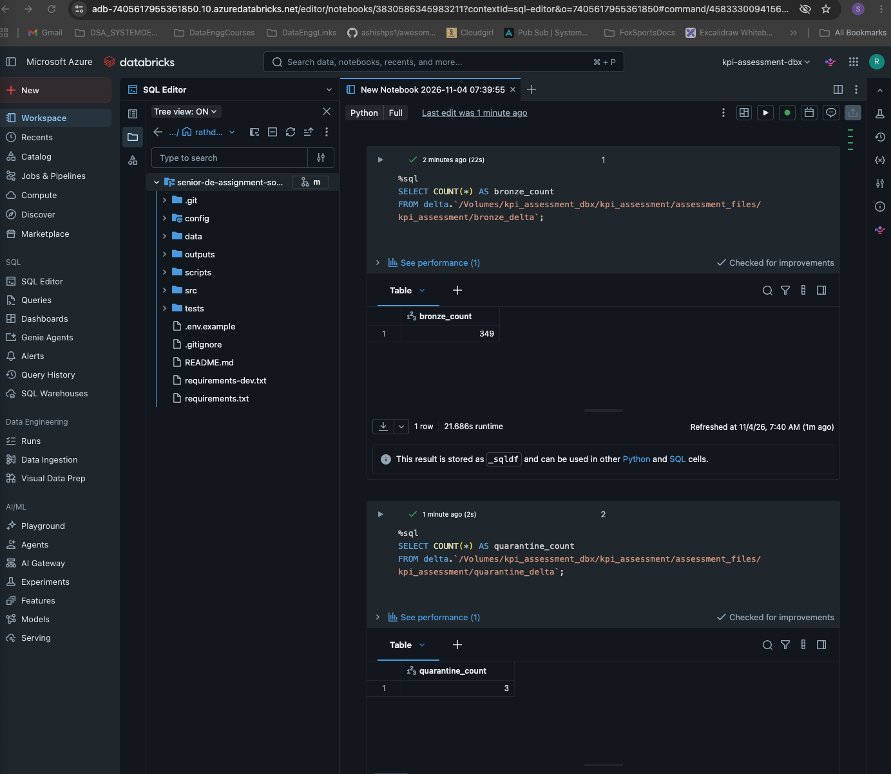
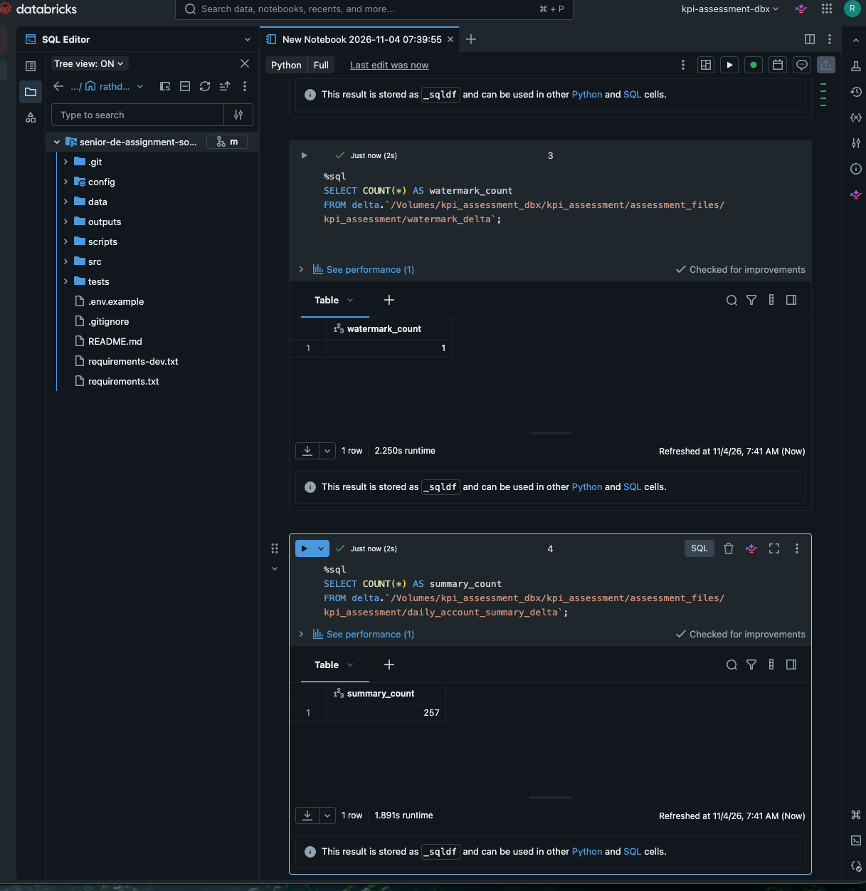
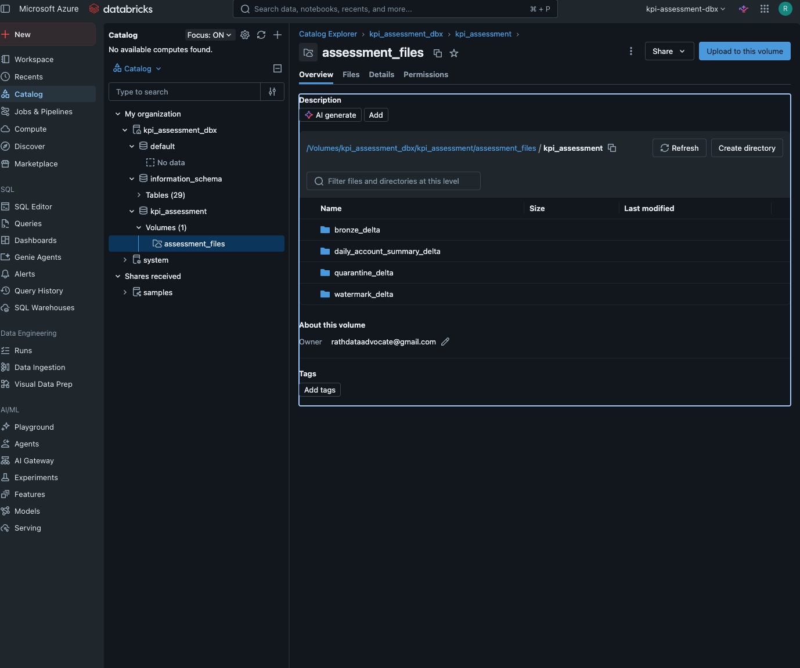

# Senior Data Engineer Take-Home Assessment

## Transaction Ingestion and Daily Account KPI Pipeline

A PySpark and Delta Lake implementation demonstrating transaction ingestion, data-quality validation, duplicate detection, incremental-processing foundations, and daily account-level KPI aggregation.

The solution uses a shared Python codebase that runs locally and on Azure Databricks, with environment-specific configuration and Unity Catalog Volume storage.

---

## 1. Project Overview

The objective is to build a reliable transaction-processing pipeline that:

- Reads the supplied transaction CSV using the provided JSON schema.
- Validates transaction structure, required fields, data types, and permitted values.
- Separates invalid records into a quarantine dataset with rejection reasons.
- Identifies duplicate business transactions without deleting source records.
- Persists valid transactions in Bronze Delta Lake.
- Generates daily account-level transaction summaries.
- Maintains transaction-date watermarks for incremental-processing support.
- Supports repeatable processing through Delta MERGE operations and automated tests.

### Implementation approach

The solution separates source ingestion, data-quality validation, duplicate detection, storage, transformation, and orchestration.

The same processing code is used in both environments. Configuration determines the input and output paths.

## 2. Architecture

```text
              HR-Provided Transaction CSV
                         |
                         v
                   csv_source.py
                         |
                         v
                Raw Transaction DataFrame
                         |
                         v
                    pipeline.py
                         |
                 Data Quality Validation
                    /          \
                   /            \
             Valid Records    Invalid Records
                   |                |
                   v                v
           Duplicate Detection  Quarantine
                   |
                   v
               Bronze Delta
                   |
                   v
          Daily Account Summary
                   |
                   v
          Daily Summary Delta

              Watermark Management
```

### Main components

| Component | Responsibility |
|---|---|
| `csv_source.py` | Reads the supplied CSV, applies the expected source columns, and attaches ingestion metadata |
| `pipeline.py` | Coordinates validation, duplicate detection, and Bronze/Quarantine persistence |
| `validation.py` | Applies schema and transaction data-quality rules |
| `duplicate_detection.py` | Identifies duplicate business transactions |
| `delta_writer.py` | Handles Delta writes and MERGE operations |
| `watermark.py` | Reads, calculates, and persists transaction-date watermarks |
| `daily_account_summary.py` | Builds account-level daily KPI summaries |
| `settings.py` | Loads environment-specific YAML configuration |
| `ingest_transactions.py` | Main execution entry point |

## 3. Technology Stack

| Technology | Purpose |
|---|---|
| Python 3.11 | Application and orchestration logic |
| PySpark | Distributed data processing and transformations |
| Delta Lake | Transactional data persistence and MERGE operations |
| Unity Catalog | Data governance and Volume storage |
| Azure Databricks | Cloud execution platform |
| PyYAML | Environment-specific configuration |
| JSON Schema | Source schema definition and validation |
| Pycountry | Country-code validation |
| Pytest | Automated testing |

## 4. Repository Structure

```text
senior-de-assignment-soumyakanta/
│
├── config/
│   ├── local.yml
│   └── databricks.yml
│
├── data/
│   └── backup/
│       ├── transactions.csv
│       └── transactions_schema.json
│
├── outputs/
│   └── samples/
│       ├── quarantine/
│       └── daily_account_summary/
│
├── scripts/
│   └── check_config.py
│
├── src/kpi_assessment/
│   ├── incremental/
│   │   └── watermark.py
│   ├── ingestion/
│   │   ├── csv_source.py
│   │   ├── ingest_transactions.py
│   │   └── pipeline.py
│   ├── quality/
│   │   ├── duplicate_detection.py
│   │   └── validation.py
│   ├── storage/
│   │   └── delta_writer.py
│   ├── transformations/
│   │   └── daily_account_summary.py
│   └── settings.py
│
├── tests/
│   ├── incremental/
│   ├── ingestion/
│   ├── quality/
│   ├── transformations/
│   ├── conftest.py
│   └── test_delta_writer.py
│
├── .env.example
├── .gitignore
├── requirements.txt
├── requirements-dev.txt
└── README.md
```

## 5. Local Development Setup

### Prerequisites

- Python 3.11
- Java 17
- Git

### Create and activate the virtual environment

```bash
python3.11 -m venv .venv
source .venv/bin/activate
```

### Install dependencies

```bash
python -m pip install --upgrade pip
pip install -r requirements.txt
pip install -r requirements-dev.txt
```

### Configure the environment

Copy the example environment file:

```bash
cp .env.example .env
```

Set:

```dotenv
APP_ENV=local
```

The application loads `config/local.yml`.

No credentials are required for the supplied CSV-based implementation.

## 6. Environment Configuration

Environment-specific paths are maintained in YAML files instead of being embedded in application code.

### Local configuration

`config/local.yml`

```yaml
paths:
  transactions_csv: data/backup/transactions.csv
  transaction_schema: data/backup/transactions_schema.json

  bronze: outputs/bronze_delta
  quarantine: outputs/quarantine_delta
  watermark: outputs/watermark_delta
  daily_account_summary: outputs/daily_account_summary_delta
  samples: outputs/samples

export_sample_outputs: true
```

### Databricks configuration

`config/databricks.yml` uses Unity Catalog Volume paths.

The configured Volume is:

```text
/Volumes/kpi_assessment_dbx/kpi_assessment/assessment_files
```

Input files:

```text
/Volumes/kpi_assessment_dbx/kpi_assessment/assessment_files/transactions.csv

/Volumes/kpi_assessment_dbx/kpi_assessment/assessment_files/transactions_schema.json
```

Delta output locations:

```text
/Volumes/kpi_assessment_dbx/kpi_assessment/assessment_files/kpi_assessment/
    bronze_delta/
    quarantine_delta/
    watermark_delta/
    daily_account_summary_delta/
```

Sample exports are disabled in the Databricks configuration because review-friendly samples were already generated locally.

### Selecting the environment

Local execution:

```bash
PYTHONPATH=src python -m kpi_assessment.ingestion.ingest_transactions
```

Databricks execution:

```text
--environment databricks
```

The Databricks task passes the environment argument through its Python script parameters.

## 7. Pipeline Execution

There is one main execution entry point:

`src/kpi_assessment/ingestion/ingest_transactions.py`

The entry point coordinates the existing modules:

1. Load environment-specific configuration.
2. Create or obtain the Spark session.
3. Read the transaction CSV.
4. Attach source and ingestion metadata.
5. Validate the input records.
6. Flag duplicate business transactions.
7. Persist valid transactions in Bronze Delta.
8. Persist invalid transactions in Quarantine.
9. Build the daily account summary from Bronze.
10. Persist the summary.
11. Update the watermark after successful data processing.
12. Export review samples when enabled.

The ingestion pipeline and transformations are shared between local execution and Databricks.

## 8. Data Quality and Duplicate Handling

### Validation

The validation module checks:

- Required transaction fields.
- Expected source schema and column structure.
- Transaction and account identifiers.
- Transaction timestamp format and validity.
- Positive transaction amounts and permitted precision.
- Currency values.
- Transaction types.
- Transaction statuses.
- Merchant categories.
- Assigned country codes.
- Missing or blank mandatory fields.

Invalid records are separated into Quarantine.

Each rejected transaction contains:

| Field | Description |
|---|---|
| `error_reason` | Explains the validation failure |
| `_ingestion_timestamp` | Processing timestamp |
| `_batch_id` | Identifies the ingestion run |
| `_source_system` | Identifies the source |
| `_source_file` | Identifies the configured source file |

### Duplicate detection

Duplicate detection compares transaction business attributes while excluding `transaction_id`.

The comparison uses:

- `account_id`
- `transaction_date`
- `amount`
- `currency`
- `transaction_type`
- `merchant_name`
- `merchant_category`
- `country_code`
- `status`

Duplicate transactions are retained in Bronze and flagged using `_is_duplicate`.

The daily summary excludes duplicate copies, preventing duplicate business activity from inflating the KPIs.

This approach preserves source records while making downstream aggregation safer.

## 9. Daily Account Summary

The daily summary includes completed transactions only and excludes duplicate copies.

The output contains:

| Field | Description |
|---|---|
| `account_id` | Account identifier |
| `transaction_date` | Transaction calendar date |
| `total_debit_amount` | Debit totals by currency |
| `total_credit_amount` | Credit totals by currency |
| `net_amount` | Credit minus debit, by currency |
| `transaction_count` | Number of eligible transactions |
| `distinct_merchants` | Number of distinct merchants |
| `top_category` | Highest debit-spend category by currency |
| `currencies` | Currencies present for the account and date |
| `updated_at` | Summary processing timestamp |

### Currency handling

The supplied data contains account-days with transactions in multiple currencies.

Adding different currencies without conversion would produce misleading financial totals.

Therefore, debit, credit, net amount, and top category are represented as currency-keyed maps.

For example:

```json
{
  "account_id": "ACC-1001",
  "transaction_date": "2024-01-09",
  "total_debit_amount": {
    "USD": 238.20
  },
  "total_credit_amount": {
    "USD": 0.00
  },
  "net_amount": {
    "USD": -238.20
  },
  "transaction_count": 1,
  "distinct_merchants": 1,
  "top_category": {
    "USD": "home_and_garden"
  },
  "currencies": ["USD"]
}
```

The daily summary is persisted using Delta MERGE keyed by `account_id` and `transaction_date`, supporting repeatable summary updates.

## 10. Incremental Processing and Watermarks

The watermark table stores:

- `source_name`
- `last_successful_transaction_date`
- `last_successful_run_timestamp`
- `batch_id`

The watermark is based on the maximum valid transaction timestamp.

The implementation includes:

- Initial extraction when no watermark exists.
- A three-day lookback calculation.
- UTC-normalized watermark handling.
- Protection against moving the stored watermark backward.
- No watermark advancement when there are no valid transaction dates.
- Watermark persistence after successful data-output processing.

Bronze records are merged using `transaction_id` to prevent duplicate transaction IDs on reruns.

**Current implementation limitation:** the CSV entry point reads the complete supplied backup file on each run. The watermark and lookback utilities are implemented and tested, but the calculated lookback is not yet applied as a filter to the CSV source.

The incremental tests simulate repeated extraction and verify watermark and idempotency behaviour.

Quarantine currently uses append writes, so repeated processing of the same invalid transaction can create additional quarantine records. A production implementation could use a transaction-keyed MERGE for current quarantine state or maintain a separate append-only rejection history.

## 11. Output Locations

### Local outputs

```text
outputs/
├── bronze_delta/
├── quarantine_delta/
├── watermark_delta/
├── daily_account_summary_delta/
└── samples/
    ├── quarantine/
    └── daily_account_summary/
```

### Databricks outputs

The same logical datasets are written under the Unity Catalog Volume:

```text
assessment_files/
└── kpi_assessment/
    ├── bronze_delta/
    ├── quarantine_delta/
    ├── watermark_delta/
    └── daily_account_summary_delta/
```

Each Delta directory contains its transaction log and Parquet data files.

The datasets are currently stored as Delta files at Volume paths; they are not separately registered as named Unity Catalog tables.

## 12. Testing and Verification

### Automated tests

Run the test suite locally:

```bash
PYTHONPATH=src python -m pytest -v tests/
```

The test suite contains 12 passing tests covering:

- Transaction validation.
- Duplicate detection.
- Delta persistence and MERGE behaviour.
- Watermark creation and advancement.
- Lookback calculations.
- Repeated incremental processing.
- Daily account summary calculations.
- Idempotent summary updates.

**Latest local test result: 12 passed.**

### Local end-to-end execution

The supplied backup dataset was processed locally with the following results:

| Metric | Result |
|---|---:|
| Input transactions | 352 |
| Valid transactions | 349 |
| Invalid transactions | 3 |
| Duplicate transactions flagged | 5 |
| Maximum valid transaction timestamp | 2024-03-30 22:35:29 UTC |

### Azure Databricks execution

The same application code was deployed through a Databricks Lakeflow Job using:

- GitHub repository integration.
- `main` branch as the Git source.
- Python script task.
- Serverless compute.
- A custom Python environment with four dependencies.
- Databricks environment argument: `--environment databricks`.
- Unity Catalog Volume input and output paths.

The job completed successfully.

The persisted Delta datasets were independently queried from a Databricks notebook to verify record counts.

| Dataset | Verified records |
|---|---:|
| Bronze Delta | 349 |
| Quarantine Delta | 3 |
| Watermark Delta | 1 |
| Daily Account Summary Delta | 257 |

The Databricks output counts matched the local ingestion results and the generated daily summary.

## 13. Assumptions, Limitations and Future Improvements

The following considerations apply before production deployment:

1. **Source availability:** The supplied backup CSV is used as the input source for the completed implementation.

2. **Incremental extraction:** Watermark and lookback utilities are implemented, but the current CSV entry point reads the complete backup dataset rather than applying an incremental source filter.

3. **Quarantine history:** Quarantine currently uses append writes. Reprocessing can create repeated rejection records. A production design should explicitly select between current quarantine state and historical rejection tracking.

4. **Late-arriving transactions:** The three-day lookback provides a foundation for handling late-arriving data. The appropriate window should be agreed with source owners and monitored.

5. **Operational monitoring:** Production deployment should track ingestion counts, validation failure rates, duplicate rates, watermark freshness, execution duration, and job failures.

6. **Currency conversion:** Cross-currency aggregation requires an agreed exchange-rate source, conversion timestamp, and base currency. This implementation deliberately avoids implicit conversion.

7. **Data governance:** Production controls should include ownership, lineage, retention, access policies, schema-change monitoring, and documented data-quality expectations.

## 14. Azure Databricks Deployment

The application was successfully executed on Azure Databricks Serverless.

Deployment components:

- Azure Databricks workspace.
- Unity Catalog catalog and schema.
- Managed Unity Catalog Volume.
- GitHub integration.
- Lakeflow Job with Python script task.
- Serverless compute.
- Environment-specific YAML configuration.

The successful run verified that the shared PySpark and Delta Lake application can execute on Databricks and persist all four datasets to the configured Volume.

## 15. Databricks Execution Evidence

The following screenshots provide evidence of the successful deployment and execution of the transaction pipeline on Azure Databricks Serverless.

### Databricks Workspace

The project was deployed from the GitHub repository and executed through a Databricks Lakeflow Job using Serverless compute.



### Delta Dataset Verification

The persisted Delta datasets were independently queried in Databricks to verify their record counts.

**Verification – Summary and Watermark**



**Verification – Bronze and Quarantine**



Verified record counts:

| Dataset | Records |
|---|---:|
| Bronze | 349 |
| Quarantine | 3 |
| Watermark | 1 |
| Daily Account Summary | 257 |

### Unity Catalog Volume Outputs

All four Delta datasets were persisted under the assessment Volume in Unity Catalog.



These screenshots demonstrate successful cloud execution, Delta persistence, and independent verification of the generated datasets.

## 16. AI Assistance and Verification

AI tools were used as development assistance for architecture discussions, implementation guidance, code review, troubleshooting, and documentation.

The implementation was reviewed through local execution, automated tests, and an actual Azure Databricks job run. The resulting outputs were independently checked in Databricks.

Design decisions, assumptions, limitations, and verification results are documented for technical review.